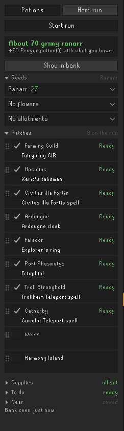
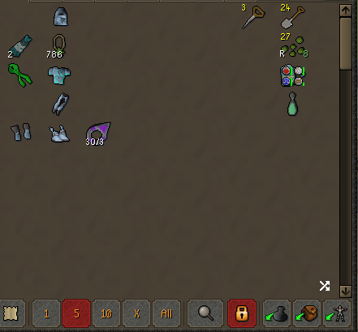

# Potion Prep

Lays out your bank for Herblore and herb runs. Pick a potion and the bank shows only what you need, in the order you use it. Switch to **Herb run** and it plans the run, lays out what to withdraw, and guides you to every patch.

## Making potions

Open the **Potion Prep** panel (green flask icon) and pick a potion from the grid. Each tile shows how many you can make from your bank and inventory. Search narrows the grid, and Enter picks the first match. The grid folds away once you've picked; click the picked potion to open it again.

Turn on **Show in bank** and your bank shows just that potion's ingredients, one row per task. Close the panel, click another bank tab, or turn the toggle off to get your normal bank back.

<p>
  
  
</p>

Below the potion, the panel shows how many are ready now and how many after prep, what ingredients you have, and the prep steps in order. Anything you're short of is listed last; hover it to see where to get it.

## Herb runs

Click **Herb run** at the top of the panel. Pick your seeds, check the patches, and turn on **Show in bank**: the bank lays out tools and compost, seeds, runes and teleports in run order, each with how many you still need to withdraw.

<p>
  
  
</p>

Then click **Start run**. The panel lists each stop with its teleport, and the teleport is highlighted wherever you use it. Once you're there, a path on the minimap leads to the patch and clears once you're beside it, and each plot ticks off as you pick, plant and compost. The run moves on by itself and stops after the last patch.

With RuneLite's **Time Tracking** plugin on, each patch shows what's growing there and its state ("Ranarr ready", "Snap 40m", "Diseased irit", Dead or Empty), and patches still growing are left out.

## Details

### Potion grid

- Red **Lv** means your Herblore level is too low.
- An orange count means you can make it with a botanical pie (+4 Herblore). The pie gets its own row in the bank, and the first step tells you to eat it.
- Hover a tile for the Herblore XP from everything you can make, including cleaning herbs and potions made along the way, and how many of each ingredient you have (unf potions and potion storage included), without picking it.
- Potions made a dose at a time keep the dose of what they're made from, so 100 super energy(3) make 100 stamina(3).

### Bank layout

Each row holds what a task needs, but not what it makes:

| Row | Superantipoison |
| --- | --- |
| Clean | grimy irit |
| Make unf | irit, vial of water |
| Crush | unicorn horn, pestle and mortar |
| Mix | irit potion (unf), unicorn horn dust |

- Potions used as an ingredient, like super energy for a stamina potion, show all four doses.
- Recipes that need full (4)s (super combat, super antifire, anti-venom+, sanfew serum) get a decant row first for the (1) to (3) doses.
- With a Herblore cape, grimy herbs go straight into the unf row.
- If you already have a crushed ingredient and none of the raw one, the crush row is left out.
- Items you don't have show faded. The finished potion isn't shown.

### Gear

Herblore gear you own (prescription goggles, amulet of chemistry or alchemist's amulet, Herblore cape) is laid out on the left of the bank like the equipment tab. Gear that's worn, in your inventory or a bank placeholder shows faded. While you're prepping a potion (the bank shows it, or you're carrying its ingredients), an infobox warns of Herblore gear you own but aren't wearing. For a herb run, you can use your own outfit instead: wear it and click **Save worn gear**.

On a herb run, items you can wear (magic secateurs, Ardougne cloak, Xeric's talisman, Explorer's ring and so on) go in any slot your saved gear leaves free.

### Seeds and patches

- Herb seeds include huasca. Limpwurt for flower patches and snape grass for allotments are optional. Seed counts include the seed vault and a seed box.
- All ten herb patches are listed. Drag one by its handle (or right-click it) to change the run order.
- Patches you can't reach yet (quests, the Morytania elite diary, 65 Farming for the guild) are skipped and say why.

### Teleports

Each patch picks the best teleport you can use: unlimited items first, then house portals, fairy rings and spells, then tablets. Click it to choose another.

- Items you don't have yet say where they come from.
- Daily-limited tiers (Ardougne cloak 2 and 3, Explorer's ring 2, Morytania legs 1 to 3) count today's uses and fall back once used up.
- House portals work with a house tablet, a Construction or Max cape, or Teleport to House.
- Hosidius can use the Tithe Farm Grouping teleport when it's off cooldown.
- Spells check your spellbook, Magic level and runes for the whole run, counting the rune pouch, combination runes, staves and tomes. Runes in your pouch are used first, so the bank only asks for what's missing. Tablets are budgeted the same way.
- To reach a fairy ring, a ring in your house is quickest: a Construction or Max cape, a house tab or Teleport to House. Otherwise any Ardougne cloak's Monastery Teleport, then a walk to the ring. The panel says which code to dial.

### Supplies

- The tool leprechaun's storage is read from the game, so tools, compost and a bottomless bucket kept there aren't asked for from the bank.
- Short of one compost? The best kind is used first and topped up with the next.
- A patch Time Tracking saw diseased adds a plant cure.
- Magic secateurs left at the leprechaun get a reminder, since they only work worn or carried.
- The bottomless bucket's uses are tracked. The rake only appears if a patch needs raking (never with Tithe Farm's Auto-weed on).

### During a run

- Until the first patch, the panel and an infobox warn in red about anything the run needs that you're not carrying or wearing (hover the infobox for the list), and closing the bank without it says so in chat.
- The teleport is highlighted in the inventory, equipment or Magic tab, then the item or spell, then the option to pick in its menu (jewellery, Xeric's talisman, spirit tree, portal nexus, quetzal whistle).
- The farming icon marks the patch on the minimap and world map. When you arrive, every patch there with something left to do is outlined, in any order you like. Each allotment is outlined on its own and drops out once it's planted and composted.
- Over each outlined patch float the icons of what to use on it next (spade, rake, plant cure, compost, seed), and the same items are outlined in your inventory. A patch ready to pick shows what you'll get from it: the grimy herb, snape grass, limpwurt root and so on. Out of compost with some left at the tool leprechaun, the leprechaun is outlined with the compost to take; with none there either, the run carries on without it.
- Each plot shows Pick, Clear, Cure, Rake, Plant + compost, Plant, Compost or Done, read live from the patch, flower patches and allotments included. An allotment or flower patch with something else still growing says Growing and is skipped. Compost and seed can go on in either order, and compost at the leprechaun counts. A dead patch says "Clear or resurrect" when you can cast Resurrect Crops.
- Out of compost or seeds, the run carries on without them. Once your herb seeds are used up, it only visits patches with something to pick or cure.
- At the end it says how many herbs you picked. Logging out keeps the run for that account.

### Harvest estimate

What you'll pick this run from the herbs, snape grass and limpwurt ready in your patches (as Time Tracking last saw them), what it adds to your potions, and what this run's plantings should give next time. Herbs use the OSRS Wiki's formula with your Farming level, compost, magic secateurs, Farming cape, Kandarin and Kourend diaries, attas and disease risk (none at Troll Stronghold, Weiss, Harmony, Hosidius with the Kourend easy diary, or Civitas illa Fortis with 16,000 Colosseum glory). Snape grass uses its own chance to save, and limpwurt is 3 roots plus a bonus that grows with Farming level. Allotments and flowers assume the crop survives. It's an average, not a promise.

### Panel sections

Every section folds when you click its heading and shows a one-line summary. During a run only To do stays open, and each state remembers what you opened.

## Settings

- **Bank column:** which column the rows line up to. 8 is the right-most.
- **Skip growing patches:** leave growing patches out of the herb run (on by default).
- **Save runes:** pick teleports that cost no runes before spells.
- **Missing items infobox:** the infobox warnings for herb run items and Herblore gear (on by default).
- **Herb run travel:** what the plugin can't see from the game: house portals (including the portal nexus), a fairy ring in your house, a mounted Xeric's talisman and spirit trees you've grown. Portals and a house fairy ring are also picked up when you visit your own house.

## Potions

Attack, Antipoison, Strength, Restore, Compost, Energy, Defence, Agility, Combat, Prayer, Super attack, Superantipoison, Fishing, Super energy, Hunter, Goading, Super strength, Haemostatic poultice, Haemostatic dressing, Prayer regeneration, Weapon poison, Weapon poison(+), Weapon poison(++), Super fishing, Super restore, Sanfew serum, Super defence, Extreme energy, Super hunter, Antidote+, Antifire, Ranging, Magic, Stamina, Zamorak brew, Antidote++, Bastion, Battlemage, Saradomin brew, Extended antifire, Ancient brew, Extended stamina, Anti-venom, Menaphite remedy, Armadyl brew, Super combat, Forgotten brew, Super antifire, Anti-venom+, Extended anti-venom+, Extended super antifire, and the divine potions (super attack, strength, defence, combat, ranging, magic, bastion and battlemage).

## Notes

- Needs the core **Bank Tags** plugin, which is on by default.
- Only how the bank is drawn changes. Nothing is moved, clicked or withdrawn for you.
- Potion storage is counted each time you open the bank.
- Your bank, potion storage and seed vault are remembered per account when you close them, so counts and plans work straight after a restart. Opening the bank updates them.
- Crushing a lava scale gives 3 to 6 shards. Counts assume 3.
- Quetzal whistle and Xeric's talisman charges come from their chat messages. Check them once so the plugin knows.

## Help and feedback

Found a bug or a wrong recipe? [Open an issue](https://github.com/EAS-Andrew/runelite-potion-prep/issues).

## Development

```sh
export JAVA_HOME=$(/usr/libexec/java_home -v 17)
./gradlew test        # planner unit tests
./gradlew runClient   # RuneLite with the plugin loaded, in developer mode
```
