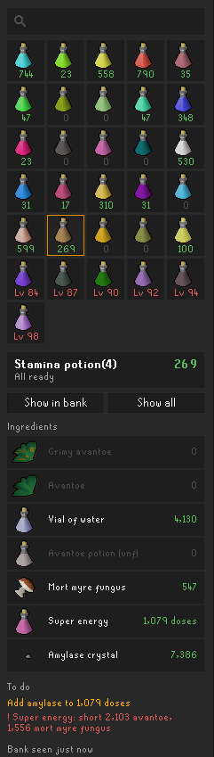

# Potion Prep

Pick a potion and your bank shows only what you need to make it, laid out in the order you use it. The side panel shows how many you can make and what to do next.

<p>
  
  
</p>

## Using it

1. Open the **Potion Prep** panel (green flask icon) and click a potion. Search narrows the grid; Enter picks the first match.
2. Turn on **Show in bank**. While it's on and the Potion Prep panel is open, your bank shows just that potion's ingredients. Close the panel, click any other bank tab, or turn the toggle off to get your normal bank back.

Each grid tile shows how many of that potion you can make from your bank and inventory. Red **Lv** means your Herblore level is too low.

## Bank layout

One row per task, in the order you do them. Each row holds what the task needs, but not what it makes:

| Row | Superantipoison |
| --- | --- |
| Clean | grimy irit |
| Make unf | irit, vial of water |
| Crush | unicorn horn, pestle and mortar |
| Mix | irit potion (unf), unicorn horn dust |

Potions used as an ingredient, like super energy for a stamina potion, show all four doses, (1) to (4). Items you don't have show faded. The finished potion isn't shown.

## Panel

- **Count:** how many you can make, and how many need prep first (cleaning, unf, crushing).
- **Ingredients:** what you have, from bank and inventory. Potions are counted in doses.
- **To do:** the prep steps in order, then anything you're short of. Hover a shortage to see where to get it.

## Potions

Attack, Antipoison, Strength, Restore, Energy, Defence, Agility, Combat, Prayer, Super attack, Superantipoison, Fishing, Super energy, Hunter, Super strength, Weapon poison, Super restore, Super defence, Antifire, Ranging, Magic, Stamina, Zamorak brew, Antidote++, Saradomin brew, Extended antifire, Anti-venom, Super combat, Super antifire, Anti-venom+, Extended super antifire.

## Settings

- **Bank column:** which column the rows line up to. 8 is the right-most.

## Notes

- Needs the core **Bank Tags** plugin, which is on by default.
- The layout only changes how the bank is drawn. Nothing is moved, clicked or withdrawn for you.
- Potions and unf potions in potion storage are counted each time you open the bank. If you haven't unlocked potion storage, only your bank and inventory are counted.
- Crushing a lava scale gives 3 to 6 shards. Counts assume 3.

## Support

Found a bug or a wrong recipe? [Open an issue](https://github.com/EAS-Andrew/runelite-potion-prep/issues).

## Development

```sh
export JAVA_HOME=$(/usr/libexec/java_home -v 17)
./gradlew test        # planner unit tests
./gradlew runClient   # RuneLite with the plugin loaded, in developer mode
```
