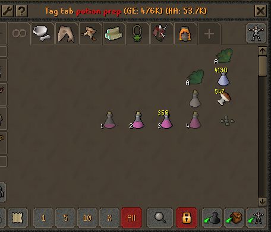

# Potion Prep

Pick a potion and your bank shows only what you need to make it, laid out in the order you use it. The side panel shows how many you can make and what to do next.

Switch to **Herb run** and it plans and guides your herb runs: which patches are ready, the best teleport you own for each, what to withdraw, and a step-by-step guide with a walking path to every patch.

<p>
  
  
</p>

## Using it

1. Open the **Potion Prep** panel (green flask icon), click the **Potion** heading and pick a potion. Search narrows the grid; Enter picks the first match. The grid folds away once you've picked, and Ingredients, To do and Gear fold the same way when you click their headings.
2. Turn on **Show in bank**. While it's on and the Potion Prep panel is open, your bank shows just that potion's ingredients. Close the panel, click any other bank tab, or turn the toggle off to get your normal bank back.

Each grid tile shows how many of that potion you can make from your bank and inventory. Red **Lv** means your Herblore level is too low. An orange count means you can make it with a botanical pie (+4 Herblore). The pie then gets its own row at the top of the bank view, and the first step tells you to eat it. Hover a tile to see the Herblore XP for everything you can make, including cleaning herbs and any potions made along the way.

Herblore gear you own (prescription goggles, amulet of chemistry or alchemist's amulet, Herblore cape) is laid out on the left of the bank view like the equipment tab. Gear that's worn, in your inventory, or left as a bank placeholder shows faded. To use your own outfit instead, wear it and click **Save worn gear**. Each mode keeps its own.

## Bank layout

One row per task, in the order you do them. Each row holds what the task needs, but not what it makes:

| Row | Superantipoison |
| --- | --- |
| Clean | grimy irit |
| Make unf | irit, vial of water |
| Crush | unicorn horn, pestle and mortar |
| Mix | irit potion (unf), unicorn horn dust |

Potions used as an ingredient, like super energy for a stamina potion, show all four doses, (1) to (4). Recipes that need full (4)s (super combat, super antifire, anti-venom+, sanfew serum) show only the (4) in the task row, with the (1) to (3) doses in a decant row before it. With a Herblore cape, grimy herbs go straight into the unf row. If you already have a crushed ingredient and none of the raw one, the crush row is left out. Items you don't have show faded. The finished potion isn't shown.

## Panel

- **Count:** how many you can make, and how many need prep first (cleaning, unf, crushing). Potions made a dose at a time keep the dose of what they're made from, so 100 super energy(3) make 100 stamina(3).
- **Ingredients:** what you have, from bank and inventory. Potions are counted in doses.
- **To do:** the prep steps in order, then anything you're short of. Hover a shortage to see where to get it.

## Potions

Attack, Antipoison, Strength, Restore, Compost, Energy, Defence, Agility, Combat, Prayer, Super attack, Superantipoison, Fishing, Super energy, Hunter, Goading, Super strength, Haemostatic poultice, Haemostatic dressing, Prayer regeneration, Weapon poison, Weapon poison(+), Weapon poison(++), Super fishing, Super restore, Sanfew serum, Super defence, Extreme energy, Super hunter, Antidote+, Antifire, Ranging, Magic, Stamina, Zamorak brew, Antidote++, Bastion, Battlemage, Saradomin brew, Extended antifire, Ancient brew, Extended stamina, Anti-venom, Menaphite remedy, Armadyl brew, Super combat, Forgotten brew, Super antifire, Anti-venom+, Extended anti-venom+, Extended super antifire, and the divine potions (super attack, strength, defence, combat, ranging, magic, bastion and battlemage).

## Herb run

Click **Herb run** at the top of the panel.

- **Seeds:** pick a herb (huasca included), and optionally limpwurt for flower patches and snape grass for allotments. Each dropdown shows how many seeds you have, counting the seed vault and a seed box.
- **Patches:** all ten herb patches. Drag a patch by its handle (or right-click it) to change the run order. Ones you can't reach yet (quests, the Morytania elite diary, 65 Farming for the guild) are skipped and say why. With RuneLite's **Time Tracking** plugin on, each patch shows Ready, Diseased, Dead, Empty or how long is left, and patches still growing are left out of the run.
- **Teleports:** each patch picks the best one you can use: unlimited items first, then house portals, fairy rings and spells, then tablets. Click it to choose another. House portals work with a house tablet, a Construction or Max cape, or the Teleport to House spell. Items you don't have yet say where they come from. Daily-limited tiers (Ardougne cloak 2 and 3, Explorer's ring 2, Morytania legs 1 to 3) count today's uses and fall back to the next option once they're used up. Hosidius can use the Tithe Farm Grouping teleport when it's off cooldown. Spells check your spellbook, Magic level and runes for the whole run, counting the rune pouch, combination runes, staves and tomes. Runes already in your pouch are used first, so the bank only asks for what's missing. Tablets are budgeted the same way.
- **Supplies:** have / need for seeds, compost, tools and runes. The tool leprechaun's storage is read from the game, so tools, compost and a bottomless bucket kept there aren't asked for from the bank. Not enough of one compost? The best kind is used first and topped up with the next. A patch Time Tracking saw diseased adds a plant cure. Magic secateurs left at the leprechaun get a reminder to take them out, since they only work worn or carried. The bucket's uses are tracked from the leprechaun, Check and each use, and the rake only appears if a patch needs raking (none at all with Tithe Farm's Auto-weed on).
- **Harvest:** what you can expect from the run, and what it adds to your potions. Herbs use the OSRS Wiki's formula with your Farming level, compost, magic secateurs, Farming cape, Kandarin and Kourend diaries, attas (read when you're in the Farming Guild) and disease risk (none at Troll Stronghold, Weiss, Harmony, Hosidius with the Kourend easy diary, or Civitas illa Fortis with 16,000 Colosseum glory). Snape grass uses its own chance to save, compost and secateurs. Limpwurt is 3 roots plus a bonus that grows with Farming level. The wiki doesn't know disease rates for allotments and flowers, so those assume the crop survives.

**Show in bank** lays out the run: tools and compost, seeds, runes, then teleports in run order, with your saved gear on the left. Run items you can wear (magic secateurs, Ardougne cloak, Xeric's talisman, Explorer's ring and so on) go in any equipment slot your saved gear leaves free. Each item shows how many you still need to withdraw. The count goes down as you take things, including runes in a rune pouch, and disappears when you have enough.

The panel's sections (Seeds, Patches, Supplies, To do, Gear) fold away when you click their heading and show a one-line summary. During a run only To do stays open, and each state remembers what you opened.

**Start run** guides you patch by patch. The panel lists each stop with its teleport and the option to pick, then a short status for each plot: Pick, Clear, Cure, Rake, Plant + compost, Plant, Compost or Done. Compost and seed can go on in either order, and compost at the leprechaun counts. On the way, the teleport is highlighted wherever you use it: the inventory, equipment or Magic tab it's in, then the item or the spell, and the option to pick in its menu (jewellery, Xeric's talisman, spirit tree, portal nexus, quetzal whistle). Once you've teleported in, those highlights stop and the path takes over. For a fairy ring, the plugin gets you to one. With a fairy ring in your house, it's the quickest: a Construction or Max cape, a house tab or Teleport to House (budgeted across the run). Otherwise any Ardougne cloak's Monastery Teleport. The item or spell is highlighted and the item laid out in the bank, then the path leads to the ring and the panel says which code to dial. Until you reach the first patch, the panel warns in red about anything the run needs that you're not carrying or wearing, and closing the bank without it says so in chat. A walking path is drawn on the ground and minimap, the game's farming icon marks the patch on the minimap and world map, and when you arrive every patch there with something left to do is outlined, in any order you like. A dead patch says "Clear or resurrect" when you can cast Resurrect Crops. Plots tick off as the game confirms planting and composting (with compost, a bottomless bucket or Fertile Soil), and the run moves on once you leave a planted patch. If you run out of compost or seeds, the run carries on without them, and once your herb seeds are used up it only visits patches with something to pick or cure. The run stops itself after the last patch and says how many herbs you picked. Logging out or disconnecting keeps the run for that account.

## Settings

- **Bank column:** which column the rows line up to. 8 is the right-most.
- **Skip growing patches:** leave patches that are still growing out of the herb run (on by default).
- **Save runes:** pick teleports that cost no runes before spells.
- **Herb run travel:** things the plugin can't see from the game: house portals (including the portal nexus), a fairy ring in your house, a mounted Xeric's talisman and spirit trees you've grown. Portal chamber portals and a house fairy ring are also picked up when you visit your own house.

## Notes

- Needs the core **Bank Tags** plugin, which is on by default.
- The layout only changes how the bank is drawn. Nothing is moved, clicked or withdrawn for you.
- Potions and unf potions in potion storage are counted each time you open the bank. If you haven't unlocked potion storage, only your bank and inventory are counted.
- Crushing a lava scale gives 3 to 6 shards. Counts assume 3.
- Quetzal whistle and Xeric's talisman charges come from their chat messages. Check them once so the plugin knows.
- The harvest estimate uses the OSRS Wiki's chance-to-save formula; it's an average, not a promise.

## Support

Found a bug or a wrong recipe? [Open an issue](https://github.com/EAS-Andrew/runelite-potion-prep/issues).

## Development

```sh
export JAVA_HOME=$(/usr/libexec/java_home -v 17)
./gradlew test        # planner unit tests
./gradlew runClient   # RuneLite with the plugin loaded, in developer mode
```
